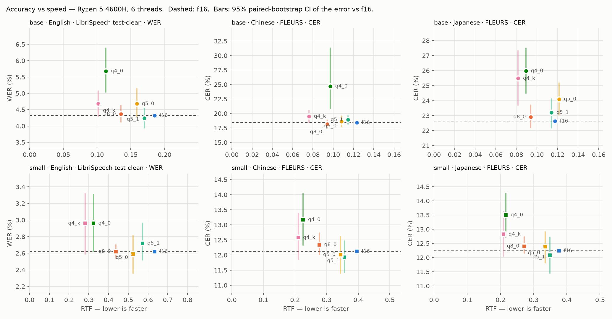
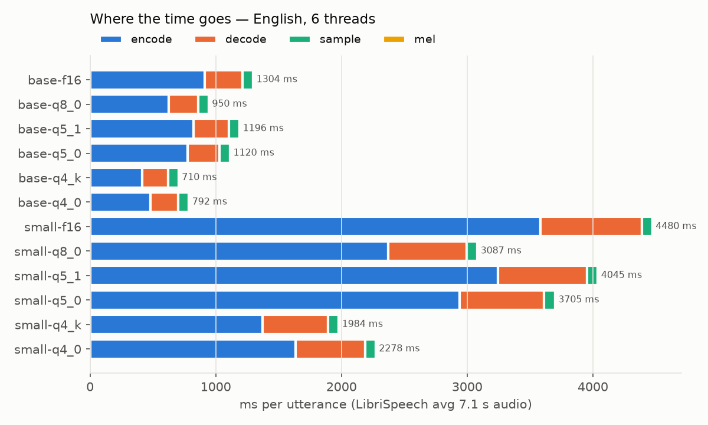
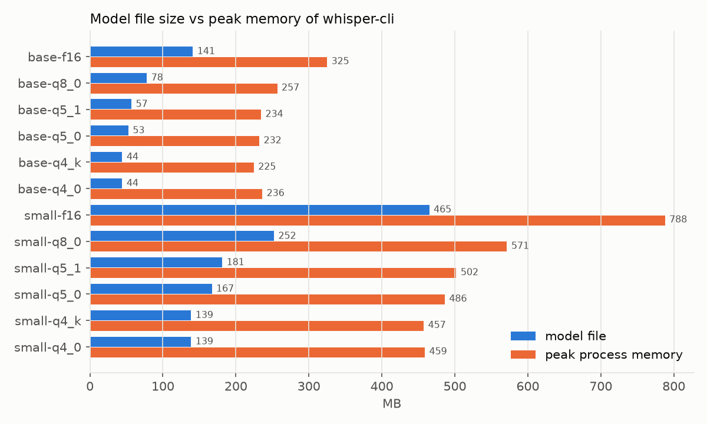

# 第 2 周：精度 / 速度 / 内存的系统评测（CPU）

## 一句话结论

**同样约 140 MB 的体积，`small-q4_k` 比 `base-f16` 准得多。** 英文 WER 2.96% 对 4.32%，中文 CER 12.6% 对 18.4%，日文 CER 12.8% 对 22.6%；代价是速度慢 1.5–1.8 倍，但仍有 3.5 倍以上的实时余量（RTF 0.21–0.28）。在端侧，"大模型再量化"优于"小模型不量化"。

只看精度损失：q8_0 和 q5 系列与 f16 的差异在统计上都不显著（只有 base-q5_0 在日文上例外）；q4_k 在 small 上不显著，在 base 的中、日文上显著；q4_0 在 6 组里有 5 组显著变差（small 英文的 CI 下限恰好是 0）。q4_k 和 q4_0 每个权重同样是 4.5 bit、文件一样大，q4_k 既更准也更快，所以 **4-bit 首选 q4_k**。

## 环境与方法

| 项目 | 值 |
|---|---|
| 机器 | AMD Ryzen 5 4600H，6 核 12 线程，2 × 8 GB DDR4-3200（同第 1 周） |
| 电源 | **插电**（BatteryStatus = 2）。电源计划仍是"平衡"，未切到"高性能" |
| 线程 | 6（第 1 周的结论：6 个物理核时 encode 已接近饱和） |
| 解码参数 | whisper-cli 默认：beam 5、best-of 5、温度回退、flash attention 开 |
| whisper.cpp | `v1.9.5-257-g482279b8`，RelWithDebInfo |

| 语言 | 数据 | 句数 | 音频时长 | 平均每句 | 指标 |
|---|---|--:|--:|--:|---|
| en | LibriSpeech test-clean | 200 | 23.7 min | 7.1 s | WER |
| zh | FLEURS cmn_hans_cn test | 100 | 20.3 min | 12.2 s | CER |
| ja | FLEURS ja_jp test | 100 | 23.0 min | 13.8 s | CER |

- **抽样**：固定种子 0 随机抽句。FLEURS 中同一句话有多人朗读，每句只保留一条录音，避免同一文本重复计分。清单在 [manifests/](../manifests/)，由 `scripts/prepare_data.py` 生成。没有用 Common Voice，因为它现在要求登录并同意条款才能下载。
- **文本归一化**：英文用 Whisper 官方的 `EnglishTextNormalizer`（统一大小写、标点和数字写法，比如 "ten" 和 "10"）。中文和日文先做 NFKC 归一化，中文再用 OpenCC 把繁体转成简体（Whisper 常输出繁体），然后去掉所有标点、符号和空白，只比较字符。
- **RTF** = (whisper 自报的 total − load) ÷ 音频时长，即不含模型加载的处理速度。CSV 里另有 `rtf_wall`，按进程墙钟时间计算，包含加载。每个 whisper-cli 进程处理 40 个文件，模型只加载一次，所以两者只差约 1%。
- **峰值内存**：用 psutil 读取 whisper-cli 进程的 `peak_wset`（Windows 的峰值工作集）。表中取三种语言里的最大值。
- **显著性**：配对 bootstrap，每组 2000 次。对句子有放回地重采样，在同一个样本上同时计算量化模型和 f16 的整体错误率之差，取 2.5% 和 97.5% 分位作为 95% 置信区间。CI 不包含 0 就记为显著。脚本是 `scripts/bootstrap_ci.py`。

原始数据：[week2_cpu.csv](week2_cpu.csv)（36 行，即 3 种语言 × 12 个模型），[week2_cpu_delta.csv](week2_cpu_delta.csv)（相对 f16 的差值和 CI），逐句的识别结果在 `hyp/week2_cpu/<lang>/<model>.jsonl`，跑分日志是 [week2_cpu_log.txt](week2_cpu_log.txt)。

## 总表

↑ 表示相对同尺寸 f16 显著变差（95% CI 不含 0）。加速比取三种语言 RTF 比值的平均。

| 模型 | 文件 MB | 峰值内存 MB | en WER % | zh CER % | ja CER % | en RTF | zh RTF | ja RTF | 加速 vs f16 |
|---|---:|---:|---:|---:|---:|---:|---:|---:|---:|
| base-f16 | 141.1 | 325 | 4.32 | 18.42 | 22.63 | 0.185 | 0.123 | 0.117 | 1.00× |
| base-q8_0 | 78.0 | 257 | 4.37 | 18.15 | 22.91 | 0.135 | 0.094 | 0.094 | 1.31× |
| base-q5_1 | 56.9 | 234 | 4.24 | 18.91 | 23.20 | 0.170 | 0.115 | 0.114 | 1.06× |
| base-q5_0 | 52.7 | 232 | 4.68 | 18.61 | 24.10 ↑ | 0.159 | 0.108 | 0.121 | 1.09× |
| base-q4_k | 44.3 | 225 | 4.68 | 19.50 ↑ | 25.48 ↑ | 0.102 | 0.076 | 0.082 | 1.63× |
| base-q4_0 | 44.3 | 236 | 5.68 ↑ | 24.70 ↑ | 25.98 ↑ | 0.113 | 0.097 | 0.089 | 1.41× |
| small-f16 | 465.0 | 788 | 2.62 | 12.12 | 12.24 | 0.633 | 0.395 | 0.376 | 1.00× |
| small-q8_0 | 252.2 | 571 | 2.62 | 12.34 | 12.40 | 0.437 | 0.277 | 0.272 | 1.42× |
| small-q5_1 | 181.3 | 502 | 2.72 | 11.93 | 12.08 | 0.572 | 0.357 | 0.349 | 1.10× |
| small-q5_0 | 167.1 | 486 | 2.59 | 12.01 | 12.39 | 0.524 | 0.344 | 0.335 | 1.16× |
| small-q4_k | 138.7 | 457 | 2.96 | 12.58 | 12.82 | 0.282 | 0.210 | 0.210 | 1.97× |
| small-q4_0 | 138.7 | 459 | 2.96 | 13.17 ↑ | 13.50 ↑ | 0.324 | 0.226 | 0.216 | 1.82× |

### 相对 f16 的误差变化（百分点，95% CI）

粗体为显著。

| 模型 | en | zh | ja |
|---|---|---|---|
| base-q8_0 | +0.05 [−0.20, +0.31] | −0.27 [−0.92, +0.43] | +0.27 [−0.43, +1.06] |
| base-q5_1 | −0.08 [−0.38, +0.22] | +0.48 [−0.25, +1.19] | +0.57 [−0.45, +1.49] |
| base-q5_0 | +0.37 [−0.03, +0.82] | +0.19 [−0.73, +1.15] | **+1.46 [+0.42, +2.55]** |
| base-q4_k | +0.37 [−0.03, +0.75] | **+1.08 [+0.08, +2.10]** | **+2.85 [+1.06, +4.69]** |
| base-q4_0 | **+1.36 [+0.72, +2.06]** | **+6.28 [+2.47, +12.84]** | **+3.34 [+1.85, +4.86]** |
| small-q8_0 | +0.00 [−0.08, +0.08] | +0.22 [−0.11, +0.61] | +0.16 [−0.08, +0.49] |
| small-q5_1 | +0.10 [−0.10, +0.34] | −0.19 [−0.69, +0.34] | −0.16 [−0.79, +0.48] |
| small-q5_0 | −0.03 [−0.26, +0.19] | −0.11 [−0.72, +0.49] | +0.15 [−0.43, +0.67] |
| small-q4_k | +0.34 [−0.03, +0.70] | +0.46 [−0.26, +1.25] | +0.58 [−0.19, +1.38] |
| small-q4_0 | +0.34 [+0.00, +0.69] | **+1.05 [+0.21, +1.92]** | **+1.26 [+0.48, +2.02]** |

## 图



每格是一个"尺寸 × 语言"组合，坐标轴各自独立。虚线是 f16 的错误率，竖条是相对 f16 差值的 95% CI，画在 f16 基线上。点越靠左下越好。





## 分析

### 1. 精度：模型越小、语言越难，对量化越敏感

- **small 比 base 更耐量化。** small 的 q8_0 和两个 q5 在三种语言上都不显著，q4_k 也不显著；base 从 q5_0 开始在日文上就显著变差。参数越多，冗余越大，单个权重的舍入误差越容易被平均掉。
- **中、日文比英文敏感。** 同样是 base-q4_k，英文 +0.37 点（不显著），中文 +1.08，日文 +2.85。Whisper 的训练数据以英文为主，非英语的决策边界更"窄"，小扰动更容易让 beam search 换到另一条路径。日文 base 的 f16 CER 本来就有 22.6%，说明 base 处理日文已经在能力边缘。
- **q4_k 比 q4_0 准，而且大小相同。** 两者都是每权重 4.5 bit。q4_0 每 32 个权重只有一个 f16 缩放因子；q4_K 是 256 个权重的超级块，里面分 8 个子块，每个子块有 6 bit 的 scale 和 min，相当于非对称量化，还多了一个偏移量，能更好地贴合权重的实际分布。差别在 base 上最明显：英文 4.68 对 5.68，中文 19.50 对 24.70。
- **q5_1 / q5_0、q8_0 偶尔比 f16 还好**（例如 small-q5_1 的中文 −0.19），但 CI 都跨过 0，只是噪声。没有 CI 的话，很容易把这种结果误读成"量化反而提升了精度"。

#### 一个案例：base-q4_0 中文 +6.28 点，有一半来自一句话

逐句看错误数，`cmn_hans_cn-1996` 一句就多出 108 个错误字符（参考文本 58 字，输出 155 字）。q4_0 在"奥德里奇("这里陷入了重复循环，直到 token 上限才停。f16 在同一位置输出的是"奥德里奇(奥德里奇)"，已经有重复的苗头，量化误差把它推进了死循环。

- 去掉这一句后，f16 的 CER 是 18.25%，q4_0 是 21.67%，**q4_0 仍然显著更差（+3.4 点）**，所以退化是真的，只是被放大了。
- 这也解释了为什么它的 CI 特别宽（+2.47 到 +12.84）：重采样时这一句有没有被抽中，结果差别很大。
- **启示**：量化带来的不只是"平均错多一点"，还有长尾的灾难性失败（幻觉、重复循环）。端侧部署时，应该在解码端加防护（重复检测、`--max-len`、根据压缩率触发温度回退），这可以作为第 4–5 周流式方案的一个设计点。

### 2. 速度：和第 1 周的 kernel 分析完全吻合

- **RTF 的排序和第 1 周 `whisper-bench` 的 encode 排序一致**：q4_k > q4_0 > q8_0 > q5_0 > q5_1 ≈ f16。q5 文件小了 60%，却只快 6–16%，因为 x86 上 q5 没有 REPACK kernel，还要拼接第 5 个 bit；q4_k 和 q4_0 有 AVX2 的 8×8 重排 kernel，所以最快。
- **时间主要花在 encoder 上。** 英文 small-f16 每句 4480 ms，其中 encode 3582 ms（80%）。base-f16 每句 914 ms 的 encode，和第 1 周 `whisper-bench` 测的 899 ms 吻合，说明两周的测量是一致的。
- **RTF 和句子长度有关，跨语言不能直接比。** 不管音频多短，encoder 都按 30 s 窗口处理，所以英文（平均 7.1 s）的 RTF 比中、日文（12–14 s）高约 50%，这并不说明英文更难。对端侧流式来说，这正是问题所在：短片段要付整段 30 s 的 encoder 代价。第 4–5 周用 VAD 切段，或者截短 encoder 输入（`-ac` / audio_ctx），是优化重点。
- **解码随语言变化**：英文 small-f16 每句 decode 806 ms，日文 1668 ms，因为句子更长、token 更多（日文平均每句 13.8 s）。

### 3. 内存：峰值约等于文件大小加一个常数

| 尺寸 | 峰值 − 文件（f16） | 峰值 − 文件（q4_k） |
|---|--:|--:|
| base | 184 MB | 181 MB |
| small | 323 MB | 318 MB |

无论权重怎么量化，额外开销基本不变：base 约 180 MB，small 约 320 MB。这部分是 KV cache（self 和 cross，f16，beam 5 下有 5 份解码状态）、计算图的中间缓冲（encoder 激活值是 1500 × d）、mel 特征和运行时自身。所以：

- 量化把 small 的峰值从 788 MB 压到 457 MB（−42%），而不是文件缩小的 70%。
- 要进一步压缩内存，就得处理这块固定开销：减小 beam（`-bs 1` 贪心解码）、减小 audio_ctx、对 KV cache 做量化。这些留给后续实验。

### 4. 推荐

| 场景 | 推荐 | 理由 |
|---|---|---|
| 精度优先、内存 ≤ 600 MB | **small-q8_0** | 精度与 f16 无显著差异，快 1.42 倍，内存 −27% |
| 平衡（默认） | **small-q4_k** | 体积与 base-f16 相当，精度高得多，RTF ≈ 0.2–0.3 |
| 极限速度 / 内存 ≤ 250 MB | **base-q4_k** | 最快（RTF 0.08–0.10）；英文可用，中、日文损失 1–3 点 |
| 不推荐 | q5_0 / q5_1（x86） | 文件小，但在 x86 上几乎不提速；在有 q5 kernel 的平台上需重新评估 |
| 不推荐 | q4_0 | 和 q4_k 一样大，却更慢、更不准 |

## 测量的局限

- **每个配置只跑了一次。** 用 `ja` 的 base-q5_0 / q5_1 重跑了一遍（[week2_cpu_recheck.csv](week2_cpu_recheck.csv)）：错误率完全相同（解码是确定性的），RTF 相差约 10%（0.121 对 0.107），所以 RTF 的个位百分比差异不可信。
- **一处计时异常已替换。** 第一次跑 `ja base-q5_1` 时 encode 平均每句 7965 ms（RTF 0.641），是其他 base 模型的 10 倍，而错误率与重跑完全一致。判断是当时系统层面的干扰（后台进程或降频）。总表里用的是重跑值（RTF 0.114），原始值保留在 [week2_cpu_log.txt](week2_cpu_log.txt)。
- **电源计划是"平衡"。** 机器插着电，但没有切到"高性能"，CPU 频率不固定，这也是计时噪声的来源之一。
- **中文数字的写法会抬高 CER。** 参考文本写"第十一名"，模型常输出"第11名"，按字符比较会算成错误。这对所有模型的影响相同，不影响量化之间的比较，但中文 CER 的绝对值偏高。日文同理。后续可以加一步数字归一化（如 cn2an）。
- **样本量**：中、日文各 100 句，CI 宽约 ±1 点，小于 1 点的差异基本测不出来。
- **还没有测线程数的影响。** GPU 对比已经做了，见 [week2_cuda.md](week2_cuda.md)：同一模型在 CPU 和 GPU 上整体错误率相同，但逐句输出经常不同，本文里约 1 个百分点、刚好显著的量化差异在 GPU 上不一定复现；另外"截短 encoder 是优化重点"只在 CPU 上成立。台式机 9700X 的纯 CPU 结果见 [week2_9700x.md](week2_9700x.md)：比 4600H 快约 3 倍，两颗 CPU 之间的逐句输出也会不同，三台机器都显著的量化退化只有 5 组。

## 复现

```bash
py -3.11 -m venv .venv
.venv/Scripts/python.exe -m pip install -r requirements.txt
.venv/Scripts/python.exe scripts/prepare_data.py                       # 下载约 1.3 GB，生成 manifests/
.venv/Scripts/python.exe -u scripts/evaluate.py --tag week2_cpu --langs en zh ja --threads 6   # 约 3 小时，可断点续跑
.venv/Scripts/python.exe scripts/bootstrap_ci.py --tag week2_cpu       # 显著性
.venv/Scripts/python.exe scripts/plot_week2.py --tag week2_cpu         # 三张图
```
