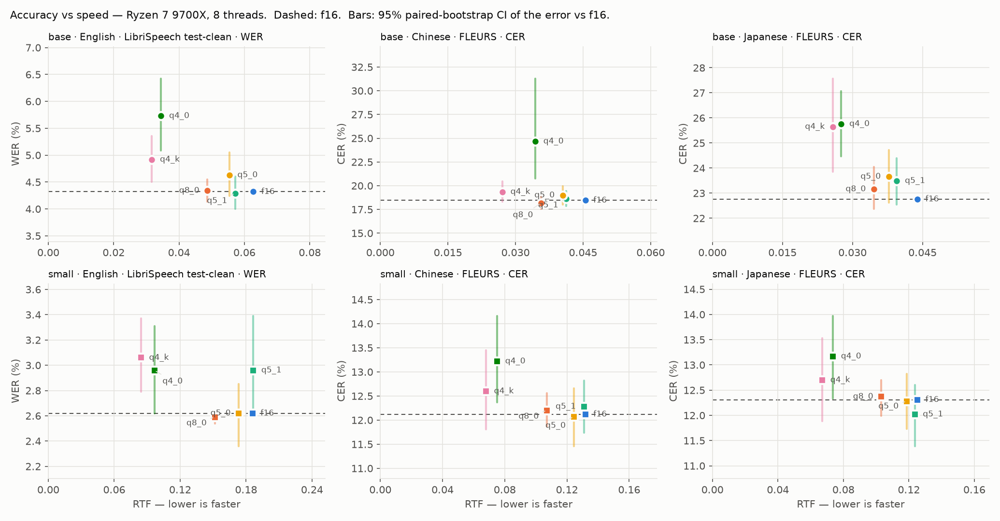
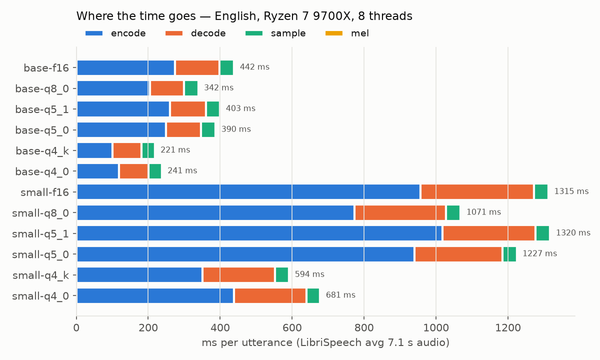
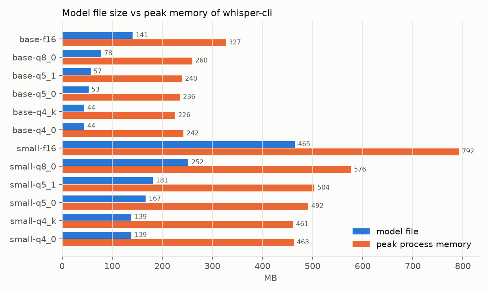

# 第 2 周（续）：台式机 CPU（Ryzen 7 9700X）基线

[week2_cuda.md](week2_cuda.md) 里的加速比是"笔记本 4600H"对"台式机 5080 + 9700X"，GPU 和 CPU 两个变量混在一起。本文在台式机上用**纯 CPU 构建**把同一套评测再跑一遍，把总加速拆成两段：**4600H → 9700X**（换 CPU）和 **9700X → 5080**（加 GPU）。

## 一句话结论

**换 CPU 带来约 3 倍（2.6–3.4×，所有模型和语言都差不多），在此基础上加 GPU 只再快 1.9–6.8 倍；GPU 对 f16 的帮助最大，对 4-bit 量化最小（base-q4_k 只有 1.9×）。** 在 9700X 上量化仍然有用（q4_k 比 f16 快 1.7–2.2 倍），所以在台式机上真正的选择是"CPU 跑 small-q4_k（RTF 0.07–0.08）"还是"GPU 跑 small-f16（RTF 0.02）"。精度上，**两颗 x86 CPU 之间的逐句输出也会不同**（日文平均 68% 相同），程度和 CPU vs GPU 差不多。所以 week2_cuda.md 发现的"数值实现不同→beam search 分叉"并不是 GPU 特有的。三台机器都显著的量化退化只有 5 组。

## 环境与方法

和 [week2.md](week2.md)、[week2_cuda.md](week2_cuda.md) 相同的 manifest、模型、whisper.cpp commit、解码参数，每个进程 40 个文件。

| 项目 | 4600H（week2_cpu） | 9700X（本文，week2_9700x） |
|---|---|---|
| CPU | Zen 2，6 核 12 线程，AVX2 | Zen 5，8 核 16 线程，AVX-512 |
| 内存 | 笔记本 DDR4 | DDR5-4800 双通道 2 × 16 GB（实测配置频率 4800，未开 EXPO） |
| 构建 | `build/`，`GGML_NATIVE=ON` | `build/`，`GGML_NATIVE=ON`（同一份源码在本机重新编译，所以用上了 AVX-512） |
| 线程 | 6 | 8（等于物理核数） |
| 电源方案 | — | 高性能 |

原始数据：[week2_9700x.csv](week2_9700x.csv)，[week2_9700x_delta.csv](week2_9700x_delta.csv)（相对 f16），[week2_cpu_vs_week2_9700x.csv](week2_cpu_vs_week2_9700x.csv)（4600H vs 9700X），[week2_9700x_vs_week2_cuda.csv](week2_9700x_vs_week2_cuda.csv)（9700X vs 5080），逐句结果在 `hyp/week2_9700x/`，日志 [week2_9700x_log.txt](week2_9700x_log.txt)。

## 总表

↑ / ↓ 表示相对同尺寸 f16 显著变差 / 变好（95% CI 不含 0）。峰值内存取三种语言的最大值；两列加速比取三种语言的平均。

| 模型 | 文件 MB | 峰值 MB | en WER % | zh CER % | ja CER % | en RTF | zh RTF | ja RTF | vs 4600H | 5080 vs 9700X |
|---|---:|---:|---:|---:|---:|---:|---:|---:|---:|---:|
| base-f16 | 141.1 | 327 | 4.32 | 18.48 | 22.76 | 0.063 | 0.045 | 0.044 | 2.8× | 3.5× |
| base-q8_0 | 78.0 | 260 | 4.34 | 18.18 | 23.16 | 0.049 | 0.036 | 0.035 | 2.7× | 2.8× |
| base-q5_1 | 56.9 | 240 | 4.29 | 18.61 | 23.49 | 0.057 | 0.041 | 0.040 | 2.9× | 3.3× |
| base-q5_0 | 52.7 | 236 | 4.63 | 18.99 | 23.66 | 0.055 | 0.041 | 0.038 | 2.9× | 3.1× |
| base-q4_k | 44.3 | 226 | 4.92 ↑ | 19.36 | 25.65 ↑ | 0.032 | 0.027 | 0.026 | 3.1× | 1.9× |
| base-q4_0 | 44.3 | 242 | 5.73 ↑ | 24.67 ↑ | 25.76 ↑ | 0.035 | 0.034 | 0.028 | 3.1× | 2.0× |
| small-f16 | 465.0 | 792 | 2.62 | 12.12 | 12.31 | 0.186 | 0.132 | 0.125 | 3.1× | 6.8× |
| small-q8_0 | 252.2 | 576 | 2.59 | 12.20 | 12.37 | 0.151 | 0.107 | 0.103 | 2.7× | 5.2× |
| small-q5_1 | 181.3 | 504 | 2.96 ↑ | 12.28 | 12.02 | 0.186 | 0.131 | 0.124 | 2.9× | 6.5× |
| small-q5_0 | 167.1 | 492 | 2.62 | 12.07 | 12.28 | 0.173 | 0.124 | 0.119 | 2.9× | 6.1× |
| small-q4_k | 138.7 | 461 | 3.06 ↑ | 12.60 | 12.70 | 0.084 | 0.068 | 0.067 | 3.2× | 3.2× |
| small-q4_0 | 138.7 | 463 | 2.96 | 13.22 ↑ | 13.17 ↑ | 0.097 | 0.075 | 0.074 | 3.1× | 3.6× |

### 加速拆解（英文 RTF）

| 模型 | 4600H | 9700X | 5080 | 换 CPU | 加 GPU | 合计 |
|---|--:|--:|--:|--:|--:|--:|
| base-f16 | 0.185 | 0.063 | 0.0137 | 3.0× | 4.6× | 14× |
| base-q8_0 | 0.135 | 0.049 | 0.0140 | 2.8× | 3.5× | 10× |
| base-q5_1 | 0.170 | 0.057 | 0.0141 | 3.0× | 4.1× | 12× |
| base-q5_0 | 0.159 | 0.055 | 0.0146 | 2.9× | 3.8× | 11× |
| base-q4_k | 0.102 | 0.032 | 0.0137 | 3.2× | 2.3× | 7× |
| base-q4_0 | 0.113 | 0.035 | 0.0139 | 3.3× | 2.5× | 8× |
| small-f16 | 0.633 | 0.186 | 0.0219 | 3.4× | 8.5× | 29× |
| small-q8_0 | 0.437 | 0.151 | 0.0229 | 2.9× | 6.6× | 19× |
| small-q5_1 | 0.572 | 0.186 | 0.0222 | 3.1× | 8.4× | 26× |
| small-q5_0 | 0.524 | 0.173 | 0.0222 | 3.0× | 7.8× | 24× |
| small-q4_k | 0.282 | 0.084 | 0.0223 | 3.3× | 3.8× | 13× |
| small-q4_0 | 0.324 | 0.097 | 0.0220 | 3.3× | 4.4× | 15× |

### 相对 f16 的误差变化（百分点，95% CI，粗体为显著）

| 模型 | en | zh | ja |
|---|---|---|---|
| base-q8_0 | +0.03 [−0.18, +0.23] | −0.30 [−0.93, +0.36] | +0.40 [−0.39, +1.29] |
| base-q5_1 | −0.03 [−0.32, +0.28] | +0.13 [−0.64, +0.96] | +0.73 [−0.22, +1.64] |
| base-q5_0 | +0.31 [−0.08, +0.73] | +0.51 [−0.44, +1.47] | +0.90 [−0.13, +1.96] |
| base-q4_k | **+0.60 [+0.18, +1.04]** | +0.89 [−0.16, +1.98] | **+2.89 [+1.10, +4.80]** |
| base-q4_0 | **+1.41 [+0.77, +2.10]** | **+6.19 [+2.26, +12.78]** | **+3.00 [+1.70, +4.30]** |
| small-q8_0 | −0.03 [−0.08, +0.00] | +0.08 [−0.25, +0.44] | +0.05 [−0.32, +0.39] |
| small-q5_1 | **+0.34 [+0.03, +0.77]** | +0.16 [−0.38, +0.70] | −0.29 [−0.92, +0.29] |
| small-q5_0 | +0.00 [−0.26, +0.23] | −0.05 [−0.66, +0.54] | −0.04 [−0.58, +0.51] |
| small-q4_k | **+0.44 [+0.17, +0.75]** | +0.48 [−0.31, +1.33] | +0.38 [−0.42, +1.22] |
| small-q4_0 | +0.34 [+0.00, +0.69] | **+1.10 [+0.25, +2.04]** | **+0.86 [+0.02, +1.66]** |

### 同一模型，4600H vs 9700X

"相同"= 归一化后的输出逐字相同的句子比例。Δ = 9700X 错误率 − 4600H 错误率（百分点，配对 bootstrap 95% CI，粗体为显著）。

| 模型 | en 相同 | zh 相同 | ja 相同 | en Δ | zh Δ | ja Δ |
|---|--:|--:|--:|---|---|---|
| base-f16 | 100% | 99% | 93% | +0.00 [+0.00, +0.00] | +0.05 [+0.00, +0.16] | +0.13 [−0.04, +0.37] |
| base-q8_0 | 96% | 66% | 55% | −0.03 [−0.21, +0.16] | +0.03 [−0.34, +0.35] | +0.26 [−0.43, +0.95] |
| base-q5_1 | 95% | 59% | 55% | +0.05 [−0.17, +0.33] | −0.30 [−0.89, +0.28] | +0.29 [−0.49, +1.14] |
| base-q5_0 | 96% | 75% | 46% | −0.05 [−0.20, +0.05] | +0.38 [−0.16, +0.98] | −0.44 [−1.14, +0.26] |
| base-q4_k | 91% | 59% | 45% | **+0.24 [+0.05, +0.42]** | −0.13 [−0.71, +0.42] | +0.16 [−0.76, +1.00] |
| base-q4_0 | 95% | 67% | 49% | +0.05 [−0.15, +0.25] | −0.03 [−0.56, +0.55] | −0.22 [−1.11, +0.79] |
| small-f16 | 100% | 99% | 98% | +0.00 [+0.00, +0.00] | +0.00 [+0.00, +0.00] | +0.07 [+0.00, +0.23] |
| small-q8_0 | 98% | 85% | 83% | −0.03 [−0.12, +0.06] | −0.13 [−0.48, +0.19] | −0.04 [−0.39, +0.31] |
| small-q5_1 | 98% | 83% | 77% | +0.24 [+0.00, +0.61] | +0.35 [−0.03, +0.77] | −0.05 [−0.46, +0.37] |
| small-q5_0 | 98% | 89% | 75% | +0.03 [−0.06, +0.12] | +0.05 [−0.22, +0.36] | −0.11 [−0.52, +0.29] |
| small-q4_k | 96% | 77% | 65% | +0.10 [−0.15, +0.40] | +0.03 [−0.32, +0.41] | −0.13 [−0.63, +0.36] |
| small-q4_0 | 100% | 87% | 75% | +0.00 [+0.00, +0.00] | +0.05 [−0.18, +0.27] | **−0.33 [−0.70, −0.02]** |

## 图







## 分析

### 1. 换 CPU：均匀的 3 倍

36 组对比的加速比都在 2.6–3.4× 之间（en 中位数 3.0×，zh 2.8×，ja 2.9×），不同模型和量化格式差别很小。按英文每句的时间分项（ms）看各部分的提速：

| | encode 4600H → 9700X | 解码（decode + batchd + prompt） | sample |
|---|--:|--:|--:|
| base-f16 | 914 → 274（3.3×） | 299 → 125（2.4×） | 84 → 40（2.1×） |
| base-q4_k | 413 → 100（4.1×） | 209 → 81（2.6×） | 82 → 38（2.2×） |
| small-f16 | 3582 → 957（3.7×） | 806 → 314（2.6×） | 85 → 41（2.1×） |
| small-q4_k | 1371 → 351（3.9×） | 524 → 202（2.6×） | 83 → 40（2.1×） |

- **encoder 提速最多（3.3–4.1×）**，符合计算密集部分的预期：核数 8 / 6 = 1.33×，再乘上每核的 SIMD 宽度和 IPC（AVX-512 对 AVX2、Zen 5 对 Zen 2）。q4_k 提速比 f16 多，说明 K-quant 的点积 kernel 在 AVX-512 上收益更大 🔍（第 3 周可以用 `perf`/VTune 看 `ggml_vec_dot_q4_K_q8_K` 的指令分布确认）。
- **解码提速 2.4–2.6×**，比 encoder 少：解码是 batch 很小的矩阵-向量乘，受内存带宽和每步的线程同步开销限制，核数和 SIMD 宽度帮得少。
- **sample 只提速约 2.1×**：这部分是单线程的 beam search 逻辑，只受单核性能影响。
- **两个没解释的现象** 🔍：① 同一颗 9700X，sample 在 CPU 构建里是约 40 ms / 句，在 CUDA 构建里是约 29 ms（week2_cuda.md 第 2 节）。一个猜测是 CPU 构建里 ggml 线程池的工作线程在 sample 期间仍在自旋等待，占用了共享资源；② 内存只跑在 DDR5-4800（主板没开 EXPO），解码的带宽受限部分在更高频率下可能还能再快一些。

### 2. 加 GPU：拆出来以后只剩 1.9–6.8 倍

- **week2_cuda.md 的"6–21 倍"里，约 3 倍来自换 CPU。** 同一台机器上 GPU 相对 CPU 的加速（三语言平均）是 base 1.9–3.5×、small 3.2–6.8×。
- **f16 从 GPU 得到的最多，4-bit 最少**：small-f16 6.8×，small-q4_k 3.2×；base-q4_k 只有 1.9×。原因和 week2_cuda.md 第 1 节一样：GPU 上所有格式一样快，而 CPU 上量化本来就快（9700X 上 q4_k 比 f16 快 1.7–2.2 倍，和 4600H 上的比例相同）。
- **small 从 GPU 得到的比 base 多**：模型越大，计算越多，GPU 的算力优势越明显；base 太小，GPU 大部分时间在等 kernel 启动和同步（cuda_guide.md 6.3 节的开销瓶颈）。
- **实际意义**：在这台台式机上，CPU 跑 small-q4_k 的 RTF 是 0.067–0.084，已经比实时快 12 倍以上。GPU 跑 small-f16 是 0.021–0.023，而且更准（en WER 2.62 vs 3.06）。如果 GPU 要留给别的任务，CPU + small-q4_k 也完全够用。

### 3. 精度：两颗 CPU 之间也会分叉

- **整体错误率相同。** 4600H vs 9700X 的 36 组里只有 2 组显著（en base-q4_k +0.24、ja small-q4_0 −0.33），9700X vs 5080 有 5 组，偶然的期望值都是约 1.8 组。
- **f16 在两颗 CPU 上几乎完全一致**（en 100%，zh 99%，ja 93–98% 相同），**量化模型分叉得多**（ja base-q5_0 只有 46%）。这和"浮点累加顺序"的解释不太一样，因为 f16 也要累加。一个猜测 🔍：同一份源码在 AVX2 和 AVX-512 上编译出的**量化点积 kernel 是不同的实现**（不同的分块、不同的 scale 累加顺序，ggml-cpu 还可能把 q4_0 等格式重排成适合本机 SIMD 宽度的布局），而 f16 的路径在两者上更接近。线程数不同（6 vs 8）本身不应影响结果：ggml 按输出的行和列切分工作，不切分归约维度。
- **两颗 CPU 之间的分叉程度和 CPU vs GPU 差不多**（逐句相同的平均比例：en 97% vs 95%，zh 79% vs 72%，ja 68% vs 55%）。所以 week2_cuda.md 第 3 节说的"数值实现的不确定性"不是 GPU 独有的，换一颗 CPU 就已经存在。
- **三台机器都显著的量化退化只有 5 组**：en / zh / ja 的 base-q4_0、ja 的 base-q4_k、ja 的 small-q4_0。另有 10 组只在一两台机器上显著（例如 en small-q4_k 只在 9700X 上显著，zh base-q4_k 在 4600H 和 5080 上显著、9700X 上不显著）。zh base-q4_0 的 `cmn_hans_cn-1996` 在三台机器上都陷入了同一个重复循环，这是唯一一个跨后端完全可复现的灾难性错误。
- **对第 2 周结论的影响**：week2_cuda.md 里"稳健 / 不稳健"的划分基本成立，现在有三个独立的实现作为证据：
  - **稳健**：q4_0 最差；base 的 4-bit 在日文上显著变差；small 的 q8_0 / q5_0 在任何机器上都和 f16 没有可测的差别。
  - **不稳健**：base 的 q8_0 / q5 在单台机器上的显著结果、small-q4_k / small-q5_1 在英文上约 0.3–0.4 个百分点的退化。这些只在一台机器上显著，不能当作量化格式本身的性质。

### 4. 内存

峰值内存和 4600H 基本相同（英文只高 1–3 MB，例如 base-f16 318 vs 316、small-f16 785 vs 784）。和 GPU 版不同，CPU 版的峰值内存随量化明显下降（small-f16 792 → small-q4_k 461 MB），所以**在 CPU 上，量化同时省时间和内存；在 GPU 上，两样都不省主机内存**。

### 5. 推荐（更新）

| 机器 | 推荐 | RTF（en） | 理由 |
|---|---|--:|---|
| 笔记本 4600H | small-q4_k | 0.28 | 量化换来近 2 倍速度，精度损失不稳健（只在 9700X 上显著） |
| 台式机，只用 CPU | small-q4_k | 0.084 | 同上；比实时快 12 倍 |
| 台式机，用 GPU | small-f16 | 0.022 | 最准；量化在 GPU 上不提速 |
| 任何机器 | 避免 q4_0 | — | 三台机器上都显著变差 |

## 测量的局限

- **每个配置只跑了一次**，没有重复。CPU 版重跑的经验是 RTF 有约 10% 的波动。
- **线程数不同**：4600H 用 6 线程，9700X 用 8 线程，都等于物理核数。"换 CPU 3 倍"包含了核数的差异（1.33×），不是单核对比；也没有在 9700X 上扫描线程数（例如 16 线程用上 SMT）。
- **内存频率**：9700X 的内存跑在 DDR5-4800，没开 EXPO。
- **没有控制频率和温度**：没有锁频，也没有记录跑的过程中 CPU 的频率和温度。

## 复现

```bash
cmake -S third_party/whisper.cpp -B third_party/whisper.cpp/build -G "Visual Studio 17 2022" -A x64
cmake --build third_party/whisper.cpp/build --config RelWithDebInfo -j 16
.venv/Scripts/python.exe -u scripts/evaluate.py --tag week2_9700x --threads 8   # 约 1 小时
.venv/Scripts/python.exe scripts/bootstrap_ci.py --tag week2_9700x
.venv/Scripts/python.exe scripts/plot_week2.py --tag week2_9700x --label "Ryzen 7 9700X, 8 threads"
.venv/Scripts/python.exe scripts/compare_tags.py week2_cpu week2_9700x
.venv/Scripts/python.exe scripts/compare_tags.py week2_9700x week2_cuda
```
