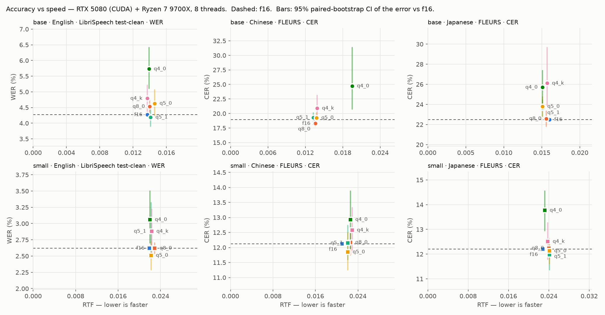
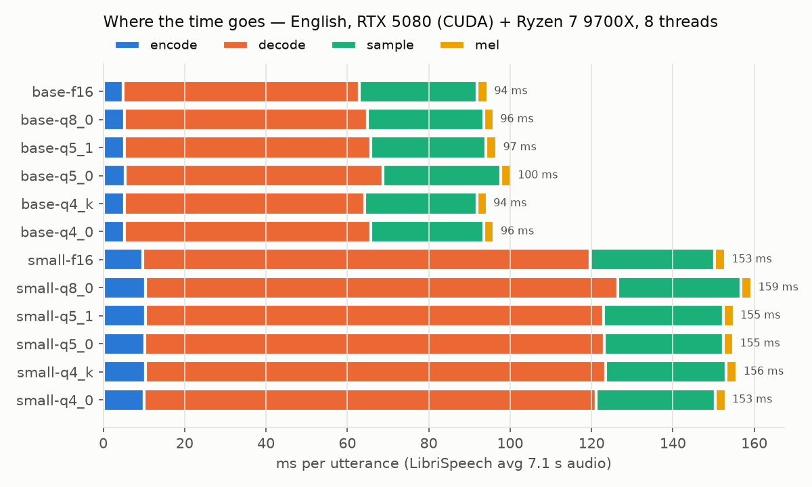
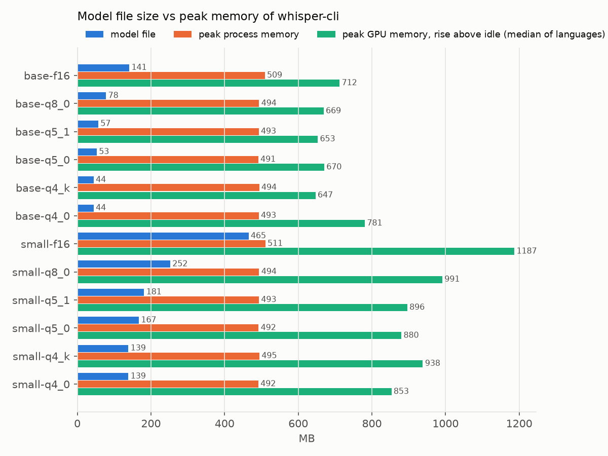

# 第 2 周（续）：同一套评测在 RTX 5080 + CUDA 上

CPU 部分见 [week2.md](week2.md)。本文用**完全相同的句子、模型和解码参数**在台式机的 CUDA 构建上重跑一遍，和笔记本 4600H 的结果对比。

## 一句话结论

**GPU 让识别快了 6–21 倍（RTF 0.013–0.024；这是相对笔记本，其中约 3 倍来自台式机 CPU 更快，同一台机器上是 1.9–6.8 倍，见 [week2_9700x.md](week2_9700x.md)），但量化在 GPU 上不再带来任何加速，时间的大头也从 encoder 变成了 beam search 解码。** 精度上，同一个模型在 CPU 和 GPU 上的整体错误率没有差别（36 组里只有 2 组显著，和 95% CI 下纯偶然的期望值 1.8 组相当），但**逐句的输出经常不一样**（日文 base-q4_0 只有 21% 的句子完全相同），所以 week2.md 里那些约 1 个百分点、"刚好显著"的量化差异，换一个后端就可能变。

## 环境与方法

和 CPU 版相同的部分：manifest（`prepare_data.py` 在这台机器上重新生成，和仓库里的文件逐字节一致）、Python 依赖版本、whisper.cpp commit、解码参数（beam 5、best-of 5、温度回退、flash attention 开）、每个进程 40 个文件。

| 项目 | 值 |
|---|---|
| GPU | NVIDIA GeForce RTX 5080（Blackwell，cc 12.0，16 GB GDDR7），驱动 621.01 |
| CPU | AMD Ryzen 7 9700X（8 核 16 线程，AVX-512）。mel 频谱、采样、beam search 在这颗 CPU 上跑 |
| 构建 | `build-cuda`：`-DGGML_CUDA=ON -DCMAKE_CUDA_ARCHITECTURES=120`，CUDA 13.4，RelWithDebInfo |
| 线程 | 8（`-t 8`，等于物理核数） |
| Python | 3.14（笔记本是 3.11，依赖版本相同） |
| GPU 状态 | 跑之前空闲：SM 1230 MHz、41 °C、44 W、P0。没有锁频 |

- **显存**：`evaluate.py --vram`，用 NVML 每 50 ms 读一次**整张卡**的已用显存，记录相对进程启动前的最大增量。Windows 的 WDDM 驱动不提供单进程显存（实测 `nvmlDeviceGetComputeRunningProcesses` 对所有进程都返回 `None`），所以只能这样测。这个增量包含 CUDA 上下文本身；其他程序同时申请显存也会被算进来，所以表里取三种语言的**中位数**（干扰只会让数变大，中位数能抵抗单次的尖峰）。
- **主机内存**：和 CPU 版一样，psutil 的 `peak_wset`，取三种语言的最大值。
- **加速比**：4600H 的 RTF ÷ 5080 的 RTF，三种语言取平均。注意这是"笔记本 CPU"对"台式机 GPU + 台式机 CPU"，不是同一台机器上 CPU 和 GPU 的对比；同一台机器上的对比见 [week2_9700x.md](week2_9700x.md)。

原始数据：[week2_cuda.csv](week2_cuda.csv)，[week2_cuda_delta.csv](week2_cuda_delta.csv)（相对 f16），[week2_cpu_vs_week2_cuda.csv](week2_cpu_vs_week2_cuda.csv)（CPU vs GPU 逐模型对比，`scripts/compare_tags.py` 生成），逐句结果在 `hyp/week2_cuda/`，日志 [week2_cuda_log.txt](week2_cuda_log.txt)。

## 总表

↑ / ↓ 表示相对同尺寸 f16 显著变差 / 变好（95% CI 不含 0）。

| 模型 | 文件 MB | 主机峰值 MB | 显存 MB | en WER % | zh CER % | ja CER % | en RTF | zh RTF | ja RTF | vs 4600H |
|---|---:|---:|---:|---:|---:|---:|---:|---:|---:|---:|
| base-f16 | 141.1 | 509 | 712 | 4.27 | 18.93 | 22.49 | 0.0137 | 0.0136 | 0.0160 | 10.0× |
| base-q8_0 | 78.0 | 494 | 669 | 4.53 ↑ | 18.31 ↓ | 22.58 | 0.0140 | 0.0136 | 0.0156 | 7.5× |
| base-q5_1 | 56.9 | 493 | 653 | 4.19 | 19.31 | 23.64 ↑ | 0.0141 | 0.0133 | 0.0151 | 9.4× |
| base-q5_0 | 52.7 | 491 | 670 | 4.63 | 19.26 | 23.79 ↑ | 0.0146 | 0.0138 | 0.0151 | 8.9× |
| base-q4_k | 44.3 | 494 | 647 | 4.79 ↑ | 20.90 ↑ | 26.11 ↑ | 0.0137 | 0.0139 | 0.0157 | 6.0× |
| base-q4_0 | 44.3 | 493 | 781 | 5.73 ↑ | 24.72 ↑ | 25.70 ↑ | 0.0139 | 0.0195 | 0.0151 | 6.3× |
| small-f16 | 465.0 | 511 | 1187 | 2.62 | 12.12 | 12.20 | 0.0219 | 0.0210 | 0.0228 | 21.4× |
| small-q8_0 | 252.2 | 494 | 991 | 2.62 | 12.17 | 12.24 | 0.0229 | 0.0226 | 0.0240 | 14.2× |
| small-q5_1 | 181.3 | 493 | 896 | 2.88 | 12.15 | 11.98 | 0.0222 | 0.0221 | 0.0241 | 18.8× |
| small-q5_0 | 167.1 | 492 | 880 | 2.51 | 11.85 | 12.13 | 0.0222 | 0.0221 | 0.0241 | 17.7× |
| small-q4_k | 138.7 | 495 | 938 | 2.88 | 12.58 | 12.51 | 0.0223 | 0.0229 | 0.0238 | 10.2× |
| small-q4_0 | 138.7 | 492 | 853 | 3.06 ↑ | 12.93 | 13.77 ↑ | 0.0220 | 0.0226 | 0.0232 | 11.3× |

### 相对 f16 的误差变化（百分点，95% CI，粗体为显著）

| 模型 | en | zh | ja |
|---|---|---|---|
| base-q8_0 | **+0.26 [+0.05, +0.50]** | **−0.62 [−1.14, −0.16]** | +0.09 [−0.67, +0.85] |
| base-q5_1 | −0.08 [−0.37, +0.19] | +0.38 [−0.46, +1.20] | **+1.15 [+0.35, +1.94]** |
| base-q5_0 | +0.37 [−0.02, +0.79] | +0.32 [−0.60, +1.20] | **+1.30 [+0.33, +2.26]** |
| base-q4_k | **+0.52 [+0.10, +0.94]** | **+1.97 [+0.36, +4.20]** | **+3.62 [+1.40, +7.16]** |
| base-q4_0 | **+1.47 [+0.84, +2.14]** | **+5.79 [+1.83, +12.40]** | **+3.22 [+1.65, +4.88]** |
| small-q8_0 | +0.00 [−0.08, +0.08] | +0.05 [−0.37, +0.44] | +0.04 [−0.20, +0.30] |
| small-q5_1 | +0.26 [−0.06, +0.70] | +0.03 [−0.52, +0.61] | −0.22 [−0.83, +0.40] |
| small-q5_0 | −0.10 [−0.33, +0.10] | −0.27 [−0.86, +0.37] | −0.07 [−0.59, +0.43] |
| small-q4_k | +0.26 [−0.10, +0.60] | +0.46 [−0.21, +1.21] | +0.31 [−0.41, +1.07] |
| small-q4_0 | **+0.44 [+0.08, +0.88]** | +0.81 [−0.16, +1.76] | **+1.57 [+0.75, +2.35]** |

### 同一模型，CPU vs GPU

"相同"= 归一化后的输出逐字相同的句子比例。Δ = GPU 错误率 − CPU 错误率（百分点，配对 bootstrap 95% CI，粗体为显著）。

| 模型 | en 相同 | zh 相同 | ja 相同 | en Δ | zh Δ | ja Δ |
|---|--:|--:|--:|---|---|---|
| base-f16 | 98.5% | 85% | 76% | −0.05 [−0.16, +0.00] | **+0.51 [+0.11, +1.05]** | −0.15 [−0.76, +0.31] |
| base-q8_0 | 95.5% | 68% | 52% | +0.16 [−0.02, +0.36] | +0.16 [−0.37, +0.73] | −0.33 [−1.17, +0.52] |
| base-q5_1 | 93.5% | 57% | 45% | −0.05 [−0.24, +0.14] | +0.40 [−0.22, +1.10] | +0.44 [−0.21, +1.18] |
| base-q5_0 | 91.5% | 59% | 32% | −0.05 [−0.27, +0.16] | **+0.65 [+0.08, +1.27]** | −0.31 [−1.08, +0.41] |
| base-q4_k | 89.5% | 55% | 40% | +0.10 [−0.11, +0.30] | +1.40 [−0.06, +3.68] | +0.62 [−0.99, +2.70] |
| base-q4_0 | 90.0% | 51% | 21% | +0.05 [−0.24, +0.35] | +0.03 [−0.57, +0.69] | −0.27 [−1.34, +0.76] |
| small-f16 | 99.5% | 92% | 92% | +0.00 [+0.00, +0.00] | +0.00 [−0.29, +0.32] | −0.04 [−0.19, +0.11] |
| small-q8_0 | 99.0% | 83% | 80% | +0.00 [−0.08, +0.08] | −0.16 [−0.54, +0.20] | −0.16 [−0.49, +0.09] |
| small-q5_1 | 98.5% | 81% | 65% | +0.16 [−0.05, +0.51] | +0.22 [−0.14, +0.63] | −0.09 [−0.58, +0.39] |
| small-q5_0 | 96.0% | 84% | 60% | −0.08 [−0.25, +0.10] | −0.16 [−0.53, +0.16] | −0.26 [−0.80, +0.35] |
| small-q4_k | 96.0% | 83% | 61% | −0.08 [−0.23, +0.03] | +0.00 [−0.28, +0.28] | −0.31 [−0.89, +0.17] |
| small-q4_0 | 96.5% | 70% | 63% | +0.10 [−0.11, +0.46] | −0.24 [−0.70, +0.18] | +0.27 [−0.30, +0.88] |

## 图



所有量化等级的点几乎落在同一条竖线上：在 GPU 上，量化不改变速度。





## 分析

### 1. 速度：快 6–21 倍，但量化不再有用

- **f16 提速最多**（base 10×，small 21×），**量化模型提速少**（base-q4_k 6×，small-q4_k 10×）。不是 GPU 跑量化慢，而是 CPU 上量化快：4600H 上 q4_k 比 f16 快 1.6–2 倍，GPU 上所有格式都一样快，比值自然被拉平了。
- **GPU 上 RTF 几乎不随量化变化**：base 都在 0.013–0.016，small 都在 0.021–0.024，差异小于测量噪声。这和 [cuda_guide.md 第 6 节](../docs/cuda_guide.md#6-第一轮-gpu-数据和分析)里 `whisper-bench` 的结论一致：GPU 上 encoder 是算力充裕、decoder 是开销瓶颈，量化省下的带宽两边都用不上。
- **唯一的例外是 zh base-q4_0（RTF 0.0195）**，原因和 CPU 版一样：`cmn_hans_cn-1996` 一句陷入重复循环（参考 58 字，GPU 输出 154 字，CPU 输出 155 字），多生成的 token 拖慢了平均值。**这个灾难性失败在两种后端上都出现，说明它来自量化本身，而不是后端的数值差异。**

### 2. 时间去哪了：瓶颈从 encoder 换成了解码

英文每句的时间构成（ms，`whisper_print_timings` 的分项，见上面的分布图）：

| | encode | batchd（beam 解码） | sample（CPU 上的 beam search） | mel | 合计 |
|---|--:|--:|--:|--:|--:|
| 4600H base-f16 | 914 (70%) | 296 (23%) | 84 (6%) | 6.5 | 1304 |
| 5080 base-f16 | 4.9 (5%) | 57 (61%) | 29 (31%) | 2.7 | 94.5 |
| 5080 small-f16 | 9.7 (6%) | 108 (71%) | 31 (20%) | 2.6 | 152.9 |

- **encoder 从占 70% 变成只占 5–6%。** 每句 encode 4.9 ms 和 `whisper-bench` 预热后的 3.7 ms 基本吻合，多出来的约 1.2 ms 符合冷启动的摊销：每个进程第一次 encode 约 69 ms（cuda_guide 6.4 节），除以 40 个文件约 1.6 ms。
- **beam 解码（batchd）成了大头**，占 61–72%。每生成一个 token，5 个 beam 一起过一遍 decoder，这正是 cuda_guide 6.3 节分析的"开销瓶颈"部分：几百个小 kernel、每步一次 CPU ↔ GPU 同步、没有 CUDA Graphs。
- **CPU 上的采样占 20–31%。** beam search 的打分、排序、温度回退都在 CPU 上做，GPU 再快也帮不上。这部分在 9700X 上是 29 ms，在 4600H 上是 84 ms，主要是 CPU 本身的差异。
- **对 CPU 版结论的修正**：week2.md 说"短片段要付整段 30 s 的 encoder 代价，第 4–5 周用 VAD 或截短 audio_ctx 是优化重点"。这在 CPU 上成立，**在 GPU 上不成立**：encoder 只占 5%，截短它几乎没有收益。GPU 上的优化方向应该是解码：减小 beam（`-bs 1`）、打开 CUDA Graphs、给 decoder 做算子融合。**同一个应用，优化重点取决于跑在什么硬件上。**

### 3. 精度：整体一样，逐句不一样

- **整体错误率没有差别。** 36 组 CPU vs GPU 对比里只有 2 组显著（zh base-f16 +0.51、zh base-q5_0 +0.65），在 95% CI 下纯偶然的期望值是 36 × 5% ≈ 1.8 组，所以可以认为两种后端的精度相同。
- **但逐句输出经常不同**：英文平均 95% 的句子相同，中文 72%，日文只有 57%；日文 base-q4_0 只有 21%。规律很清楚：**f16 > 量化，small > base，英文 > 中文 > 日文**。
- **原因** 🔍：两个后端的数值计算不同。浮点加法的顺序不同（GPU 的矩阵乘按 tile 并行累加），f16 在 GPU 上走 cuBLAS Tensor Core，量化格式在 GPU 上把激活量化成 int8 后用 MMQ / MMVQ（cuda_guide 5.3 节），和 CPU 的 kernel 不是同一套舍入。这些差异本身极小，但 beam search 是离散选择：两条候选路径分数接近时，一点点扰动就会换一条路。模型越不确定（base、量化、非英语），分数接近的情况越多，输出就越容易分叉。分叉以后的两种结果平均来说一样好，所以整体错误率不变。
- **这对 week2.md 的结论意味着什么**：两个后端都显著的只有 7 组：en / zh / ja 的 base-q4_0、zh / ja 的 base-q4_k、ja 的 base-q5_0、ja 的 small-q4_0。只在一个后端显著的有 6 组，比如 base-q8_0 在 GPU 上英文显著变差、中文显著**变好**，在 CPU 上都不显著。所以：
  - **稳健的结论**（两种后端一致）：q4_0 最差；base 的 4-bit 在中、日文上显著变差；small 比 base 耐量化；small 的 q8_0 / q5 和 f16 没有可测的差别。
  - **不稳健的结论**：约 0.3–1 个百分点、CI 刚好不含 0 的差异。这种差异和"换一个后端"引起的波动是同一个量级，不能当作量化格式本身的性质。
  - 这也说明配对 bootstrap 只衡量了"句子抽样"的不确定性，没有衡量"数值实现"的不确定性。要更可靠，就要扩大样本，或者把多个后端的结果合在一起看。

### 4. 内存

- **主机内存基本固定在约 490–510 MB，和模型大小无关**（small-f16 的文件就有 465 MB，峰值也只有 511 MB）。说明权重上传到显存后没有留在主机内存里。这 490 MB 的大头可能是 CUDA 运行时和 cuBLAS 的 DLL 被映射进进程后计入的工作集 🔍（第 3 周可以用 VMMap 看具体是哪些模块）。所以在 GPU 上，**主机内存和量化无关**；CPU 版里 small-f16 的主机峰值是 788 MB。
- **显存随模型变大**：small-f16 1187 MB → small-q4_k 938 MB（−21%），差值 249 MB 和文件差 326 MB 同一量级。base 的显存只在 647–781 MB 之间，比文件大小（44–141 MB）大得多，说明大部分是**和模型无关的固定开销**：CUDA 上下文、cuBLAS 工作区、KV cache 和计算缓冲（base f16 的 KV + 计算缓冲按日志约 170 MB，见 [jd_knowledge.md 7.2 节](../docs/jd_knowledge.md#72-内存优化)）。
- **一个没解释的现象** 🔍：base-q4_0（781 MB）比 base-f16（712 MB）还多。可能是 MMQ 需要额外的缓冲（把激活量化成 int8），或者 ggml-cuda 的内存池按需增长、在不同模型上停在了不同大小。第 3 周用 Nsight Systems 的 CUDA 内存跟踪确认。
- **在 16 GB 显存上，这些模型都很小。** 显存不是限制，这也是为什么量化在 GPU 上的唯一收益（省显存）在这台机器上没有意义。

### 5. 推荐

| 场景 | 推荐 | 理由 |
|---|---|---|
| 有 NVIDIA 独显 | **small-f16** | 最准；量化不提速；显存只要约 1.2 GB |
| 显存紧张（核显、小显存卡） | small-q8_0 | 精度与 f16 无差别，显存 −17% |
| 想要更高精度 | 换更大的模型（medium、large-v3-turbo） | RTF 还有 40 倍以上的余量；这是后续可以补的实验 |
| 不推荐 | 在 GPU 上用 4-bit | 不快、更不准，只省几百 MB 显存 |

**和 CPU 版放在一起看**：在 4600H 上推荐 small-q4_k（量化换来近 2 倍速度），在 5080 上推荐 small-f16（量化什么都换不来）。**"该不该量化"没有通用答案，取决于硬件的瓶颈在哪里。**

## 测量的局限

- **每个配置只跑了一次。** GPU 时钟没有锁定，温度和功耗会影响频率。CPU 版重跑的经验是 RTF 有约 10% 的波动，这里的个位数百分比差异同样不可信。
- **显存是整张卡的读数**，其他程序（浏览器、桌面）同时申请显存会算进来。例子：ja base-f16 读到 1047 MB，en / zh 是 712 / 705 MB，很可能是同时有别的程序在用显存。表里取中位数，但单个数字仍有几十 MB 的不确定性。
- **加速比混合了两个变量**：GPU 替代了 CPU 做矩阵乘，同时 CPU 部分（mel、采样）也从 4600H 换成了 9700X。已在 [week2_9700x.md](week2_9700x.md) 补上 9700X 的纯 CPU 基线：换 CPU 约 3×，同一台机器上 GPU 相对 CPU 是 1.9–6.8×。
- **冷启动包含在内**：每 40 个文件启动一次进程，第一次 encode 的约 65 ms 额外开销被摊进了平均值（约 1.6 ms / 句）。
- **线程数**：GPU 版用 8 线程，CPU 版用 6 线程。对 GPU 版来说线程只影响 CPU 上的那部分（mel、采样），没有扫描线程数的影响。

## 复现

```bash
py -3.14 -m venv .venv
.venv/Scripts/python.exe -m pip install -r requirements.txt
.venv/Scripts/python.exe scripts/prepare_data.py
.venv/Scripts/python.exe -u scripts/evaluate.py --tag week2_cuda --threads 8 --vram --bin third_party/whisper.cpp/build-cuda/bin/RelWithDebInfo
.venv/Scripts/python.exe scripts/bootstrap_ci.py --tag week2_cuda
.venv/Scripts/python.exe scripts/plot_week2.py --tag week2_cuda --label "RTX 5080 (CUDA) + Ryzen 7 9700X, 8 threads"
.venv/Scripts/python.exe scripts/compare_tags.py week2_cpu week2_cuda
```

`build-cuda` 运行时要能找到 CUDA 的 DLL（`cudart64_*.dll`、`cublas64_*.dll`）。安装 CUDA Toolkit 后新开的终端里 `PATH` 已经包含 `<CUDA>\bin\x64`。
